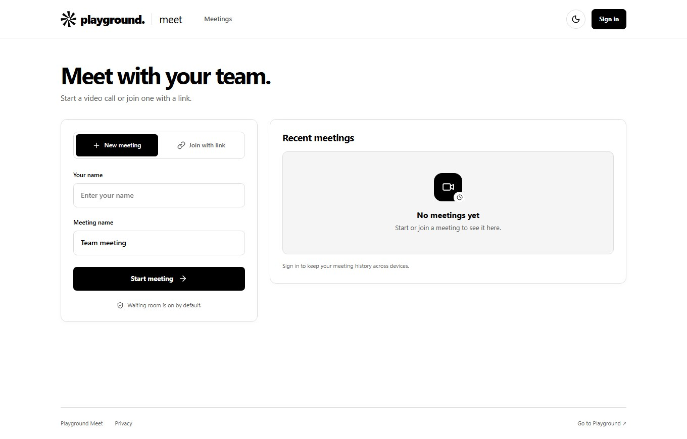
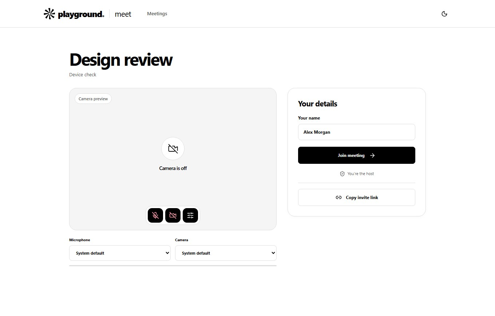
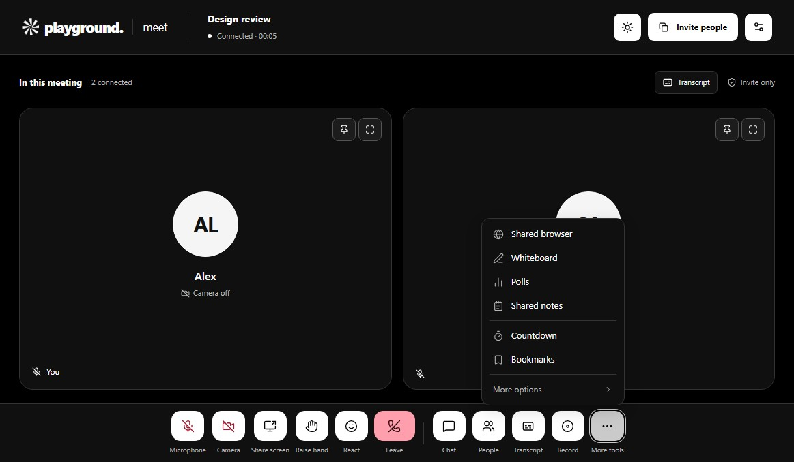
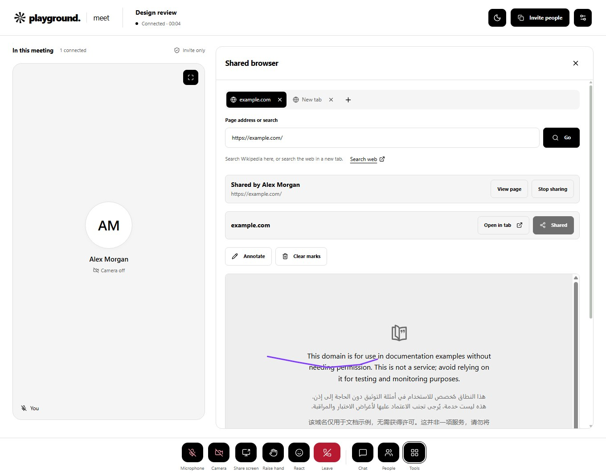
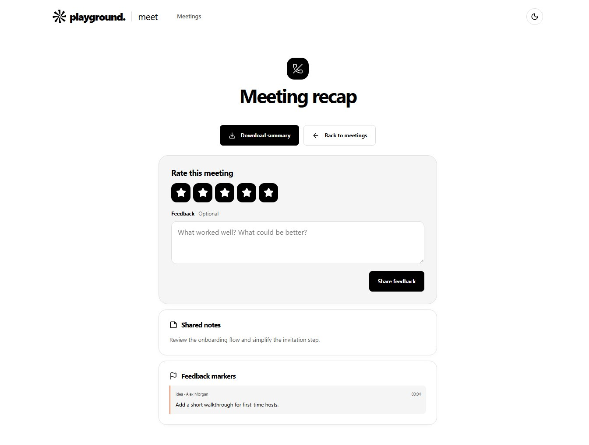

# Playground Meet

Start a video call from your browser, invite people with a link, and keep the discussion and feedback in one place. Playground Meet pairs LiveKit calls with a shared browser, notes, a whiteboard, and an exportable meeting recap.

[**Open Playground Meet**](https://playground-meet.vercel.app/) · [Run locally](#run-locally) · [Deploy on Vercel](docs/VERCEL.md) · [MIT license](LICENSE)



## What you can do

| Feature                  | What it does                                                                                                                                                      |
| ------------------------ | ----------------------------------------------------------------------------------------------------------------------------------------------------------------- |
| **Start or join a call** | Create a meeting as a guest, share its invite link, and check your camera and microphone before joining. Sign in to keep meeting history across devices.          |
| **Run the meeting**      | Admit guests from the waiting room, lock the room, moderate participants, or end the call for everyone. Share your screen and pin a participant in your own view. |
| **Browse together**      | Search privately, then show the results to everyone inside Meet. Present a browser window live or share an annotated link.                                        |
| **Work together**        | Use chat, reactions, raised hands, shared notes, a whiteboard, polls, action items with owners and due dates, a decision log, and a product review brief.         |
| **Follow up**            | Review notes and timestamped feedback, rate the meeting, and download a Markdown summary.                                                                         |

### Meeting tools

Hover over **More tools** or tap it to open the menu. **Countdown** lets the host start, pause and resume a room-wide timer. **Bookmarks** saves labeled timestamps in the recap and downloadable summary. Action items, Decision log and Product review are under **More options**.

### Notes and polls

Open **More tools → Notes** to write privately in the current tab. **Share with everyone** puts a live copy on the meeting stage. One person presents a note at a time. The presenter can switch on **Allow others to edit**. **Only me** withdraws the presenter’s note and keeps a private copy. A host can also stop a presentation. Notes still shared when the meeting ends appear in the recap. Older saved meeting notes remain available separately.

In **Polls**, the host can open a question with two to six answers. Participants can change their votes until the host closes the poll. The speaker button controls that participant’s sounds for opening, vote confirmation and closing.

### Search and browse together

In **More tools → Shared browser**, enter a query and choose **Search**. Your browser sends it to Mwmbl and shows a private preview. Choose **Share to all** to show the same results inside everyone’s meeting, including people who join later. The presenter or host can choose **Stop sharing**. Opening a result previews it for you.

To present a live website, expand **Present a tab or window**. Use **Open window**, return to Meet, select **Choose tab or window**, and pick the surface to present. Participants see the live page as you scroll, type and navigate. **Stop presenting** ends the stream. Protected media and operating-system capture restrictions can limit what the browser shares.

**Links & annotations** opens the link workspace. Participants can follow the meeting’s shared URL and draw together on pages that permit embedding.

### Helium browser

**Open in Helium** launches a separate Windows browser window with Helium’s built-in ad blocking. On the presenter’s Windows PC, run `npm run setup:helium` once from this checkout with Node installed. Setup downloads the official x64 or ARM64 portable release, verifies its SHA-256 digest, and registers the `meet-helium` URL handler for that Windows user. Run it again to install the latest release. When presenting from a different browser, select the Helium **window** in the capture picker.

On macOS or Linux, open the meeting in Helium and use **Open window**. Other participants can watch in their own browsers. [Helium project and official downloads](https://github.com/imputnet/helium)

### Blur your camera background

During a call, turn on your camera and open **Device settings → Background blur**. The preview shows the same effect other participants receive. Blur stays on when you hide the preview or turn your camera off and back on. Switch it off to share the original picture again.

The browser downloads the model from Playground Meet and processes camera frames on your device. This requires WebGL 2 and a compatible browser video pipeline. No API key or paid processing service is required.

### Record a meeting locally

Select **Record** in the call toolbar. Confirm, then choose the meeting tab in the browser picker. The recording follows what is visible in that tab, including cameras, screen shares, the whiteboard and open panels. Enable tab audio in the picker to include playback from chat videos and embedded pages. Meeting voices are included with either audio choice.

Participants, including anyone joining late, see who is recording. **Stop and save recording** downloads a video. Leaving or disconnecting also stops capture. The recap’s **Local recordings** section lets you download another copy or delete the browser copy on the same device and browser profile. Desktop Chrome and Edge support the tab picker. Available recording time depends on free browser storage.

### Live transcription and meeting notes

Open **Transcript** in the meeting and select **Include my microphone**. Each speaker opts in separately. Meet uses NVIDIA Parakeet TDT 110M, an English model also offered by [OpenWhispr](https://github.com/OpenWhispr/openwhispr), with Silero voice detection to filter out non-speech. Recognition runs in the participant’s browser and shares finalized text with the speaker’s name and timestamp. Muting pauses microphone capture. Meet switches to Whisper if Parakeet fails. You can also select **Whisper** or **Lite** before starting.

In Chromium, Parakeet with Silero had a **2.77% word error rate** (23 edits across 829 words), compared with 3.98% for Whisper Base English using the same phrase splitter. The test used the first clip from each of 40 speakers in the [LibriSpeech clean validation split](https://huggingface.co/datasets/openslr/librispeech_asr/tree/71cacbfb7e2354c4226d01e70d77d5fca3d04ba1/clean/validation). It measures clean read English, so results can differ with noise or overlapping speech.

In **Transcript → Caption language for me**, each viewer can translate finalized English captions into Spanish, French, German, Hindi, Portuguese, or Simplified Chinese. The transcript panel shows the original alongside the translation. Close the panel to see new translated captions over the call. To turn translation off, select **English (original)**. The meeting transcript and exports keep the original English text.

The first dev start or build downloads and verifies the Parakeet assets (about 142 MiB), Whisper assets (about 97 MiB), and six OPUS-MT language packs (about 665 MiB combined). Meet serves these assets, and each browser downloads models as needed. The first translation in a language loads a pack of about 107–114 MiB plus the shared runtime. Transcription and translation require no API key, subscription, or per-minute fee.

After the meeting, open **Meeting recap → Meeting transcript** and choose **Download TXT** or **Download PDF** for the full speaker transcript. While other participants finish transcribing their last phrase, the recap shows a short finalization status.

Leaving a meeting downloads a Markdown summary of the discussion so far. Ending it for everyone downloads the final notes for connected participants. Notes include spoken highlights, a timestamped transcript, shared notes, decisions and action items. The recap also has a manual download button.

Invites and recaps use the branded `/playground-meet/` route. Existing `/room/` links redirect to the same meeting.

## A look inside

These screenshots show the current local build with example meeting data.

| Device check                                                                                         | In-call tools                                                         |
| ---------------------------------------------------------------------------------------------------- | --------------------------------------------------------------------- |
|  |  |

| Shared browser                                                                                        | Meeting recap                                                                                      |
| ----------------------------------------------------------------------------------------------------- | -------------------------------------------------------------------------------------------------- |
|  |  |

In a meeting, open **React → Browse stickers** to search the library. **Studio stickers** has 100 illustrated 3D action avatars. Filter by **Tech figures** (80) or **World leaders** (20), or search by name or gesture. **City postcards** features 58 landmark photographs, and **People & punchlines** has 53 captioned portrait cutouts. **Meeting memes** includes illustrated reactions like “You're on mute” and “One last slide…” alongside the photo memes. **Hardware & tech** has 105 logos and **Developer logos** has 111 colourful 3D logos. Choose **Edit pins** to save up to six favorites. Each browser starts with Jensen Huang, Elon Musk and a laughing terminal.

In **Chat**, choose **Everyone** or an admitted participant under **Send to**. Send text, pick a sticker, or share a named place or a device location. **Files** accepts multiple documents, presentations, images and other files up to 200 MB each. You can also drop files on the chat panel. Direct messages and their attachments are accessible only to the sender and recipient within the meeting. File contents are stored in the meeting database and removed with the room.

Open **More tools → Whiteboard** to draw on the meeting’s fullscreen canvas. Choose **Share to all** to present it alongside participant video. Admitted participants can draw together, see who is drawing, undo their own marks, and export the saved artwork as a landscape PDF. The presenter or host can stop presenting, and the host can clear the canvas.

## Run locally

Install Node.js 22 or later and a [local LiveKit server](https://docs.livekit.io/transport/self-hosting/local/).

```sh
git clone https://github.com/PRABHMANNAT/playground-meet.git
cd playground-meet
npm ci
cp .env.example .env.local
livekit-server --dev --bind 127.0.0.1
```

On Windows, use `Copy-Item .env.example .env.local` and run the LiveKit Windows executable. In a second terminal, start the app.

```sh
npm run dev
```

Open [localhost:3000](http://localhost:3000/). Local data persists in PGlite under `.data/meet`, so you can start without a hosted database. See the [local development guide](docs/LOCAL-DEVELOPMENT.md) for configuration and troubleshooting.

## Deploy and verify

- [Vercel](docs/VERCEL.md) connects the Next.js app to hosted PostgreSQL and LiveKit. You can use the assigned `vercel.app` domain.
- [Docker](docs/DEPLOYMENT.md) runs the stack on your own host with HTTPS and TURN.
- [Architecture](docs/ARCHITECTURE.md), [security](docs/SECURITY.md), and [Playground SSO](docs/INTEGRATION.md) cover the app and its integrations.

The app uses Next.js, TypeScript, and React. LiveKit carries media over WebRTC. PostgreSQL stores meeting state in production. Rooms support up to 25 identities.

```sh
npm run typecheck
npm test
npm run build

# With the app and LiveKit running locally
npm run test:links
npm run test:integration
npm run test:media
```

See the [testing guide](docs/TESTING.md) for coverage and test requirements.

## Contributing and license

Open a [GitHub issue](https://github.com/PRABHMANNAT/playground-meet/issues) with reproduction steps for bugs or a short description of the workflow you want to improve. See [SECURITY.md](docs/SECURITY.md) for the app's security model.

The project code is available under the [MIT License](LICENSE). Playground branding, bundled fonts, and other third-party assets retain their respective rights. See [THIRD-PARTY-NOTICES.md](THIRD-PARTY-NOTICES.md).
