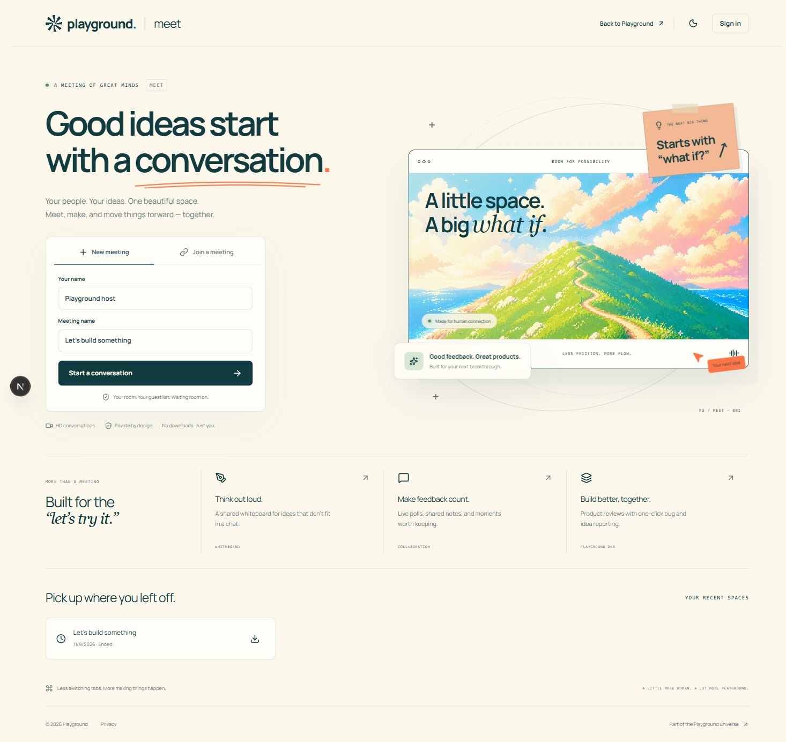
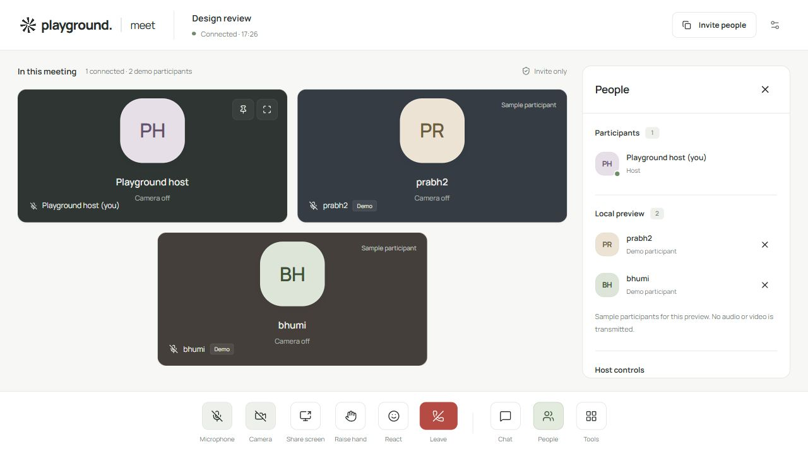

# Playground Meet

A browser-based meeting space for Playground: Next.js, TypeScript, Motion, Tailwind, LiveKit and PostgreSQL. No paid APIs, AI service or Browserbase integration.



## Delivery status

The implementation is pushed to [PRABHMANNAT/playground-meet](https://github.com/PRABHMANNAT/playground-meet). The initial delivery contained 160 non-empty commits; later interface improvements are recorded in subsequent commits. Build, 30 unit tests, independent-user API scenarios and real LiveKit audio/video/screen transport tests pass; see [verification evidence](docs/VERIFICATION.md).

**Public hosting is pending.** No production server or DNS access was available, and the connected hosting account denied access. `meet.tryplayground.net` has not been deployed. The included setup avoids paid APIs and does not purchase hosting.

## Run locally

Requires Node 22+ and a [LiveKit server](https://docs.livekit.io/transport/self-hosting/local/).

```sh
npm ci
cp .env.example .env.local
livekit-server --dev --bind 127.0.0.1
# In a second terminal:
npm run dev
```

Open **http://localhost:3000** (use localhost, matching APP_URL). On Windows, use `Copy-Item .env.example .env.local` and the official Windows LiveKit executable. No database account is needed locally; PGlite persists data in `.data/meet`.

Local development meetings include two clearly labeled **demo participants**, `prabh2` and `bhumi`, to preview the grid. They are visual samples, not connected users: they publish no media, do not enter server membership or participant counts, and cannot receive chat or notes. Hide them from **Tools → Hide demo participants**, or remove them individually in **People**. They are disabled in production builds and on non-localhost hosts.



## What works

- HD adaptive video/audio, camera/microphone preview, device selection, screen sharing, speaker highlighting, participant pinning, picture-in-picture, fullscreen and keyboard shortcuts.
- Instant invitation links, persistent guest sessions, optional password accounts, waiting rooms, host admission/removal/muting, room locking and end-for-all.
- Persistent chat, raised hands, reactions, collaborative drawing, conflict-aware shared notes, polls, focus timers and shared product-review briefs.
- Timestamped bug/idea/moment reports, ratings, meeting history and Markdown summaries assembled without AI.
- Official Playground mark, Manrope font and landscape; responsive light/dark themes and reduced-motion support.

Collaboration uses authorized conditional polling (1.2 seconds foreground, 5 seconds background); media uses actual WebRTC through LiveKit. This is optimized for small product-testing sessions, capped at 25 identities per room. It is not an unlimited enterprise conferencing service.

## Deployment and verification

- [Production deployment](docs/DEPLOYMENT.md) — `meet.tryplayground.net`, HTTPS, DNS and TURN.
- [Free-tier and capacity limits](docs/FREE-TIERS.md)
- [Local setup](docs/LOCAL-DEVELOPMENT.md)
- [Architecture](docs/ARCHITECTURE.md) and [security model](docs/SECURITY.md)
- [Playground SSO integration](docs/INTEGRATION.md)
- [Design sources](DESIGN.md)
- [Testing guide](docs/TESTING.md)

```sh
npm run typecheck
npm test
npm run build
# With local Next.js and LiveKit running:
npm run test:integration
npm run test:media
```

Public deployment needs a server, control of the domain’s DNS, and GitHub authentication for pushing. The included deployment files do not provision a paid server or enable billing.
