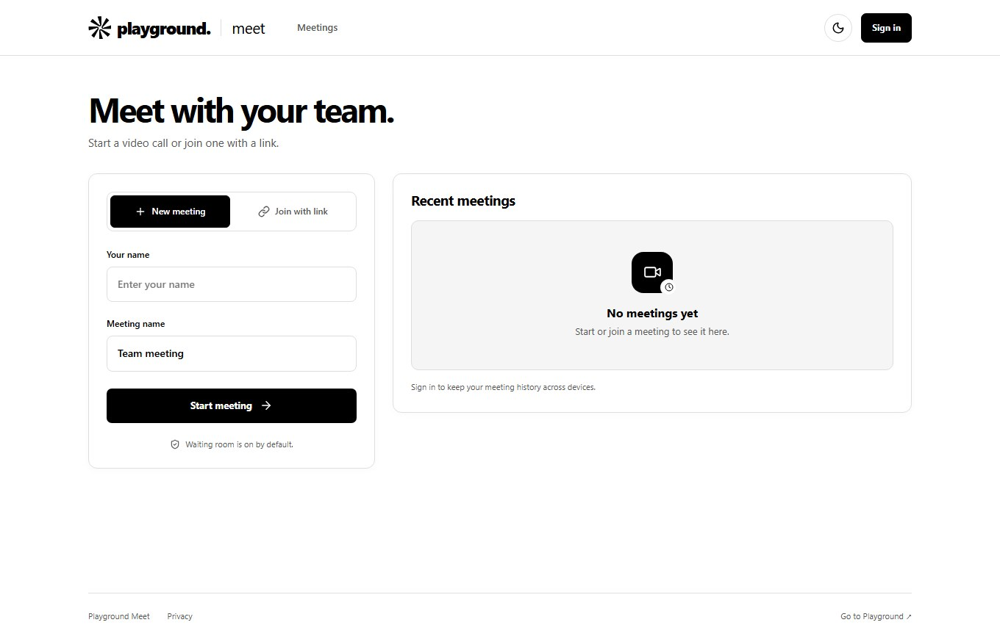
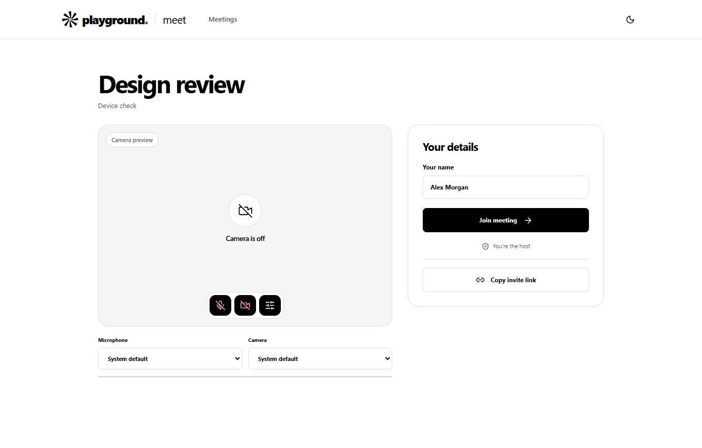
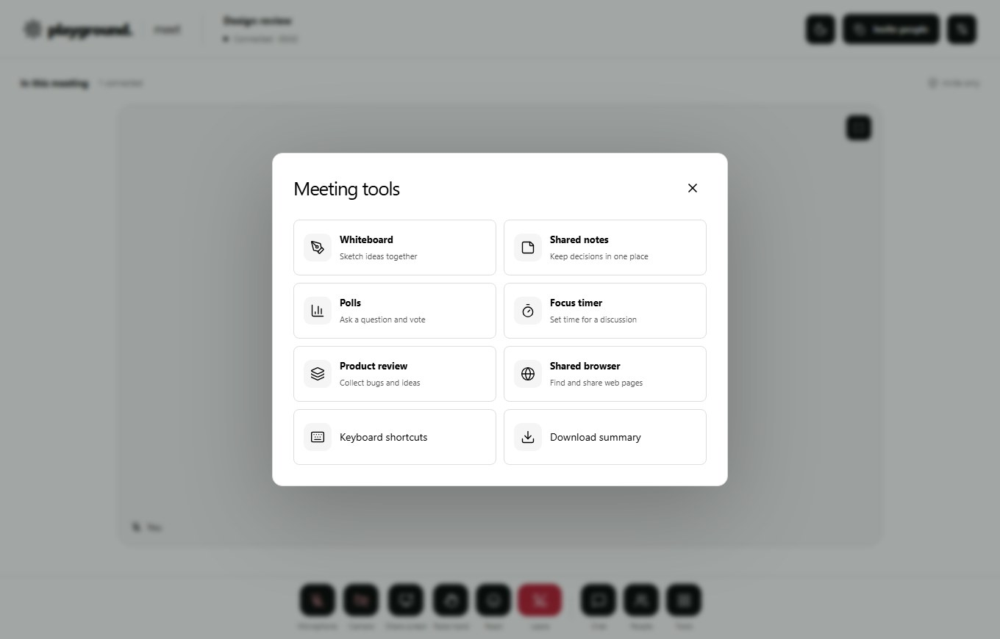
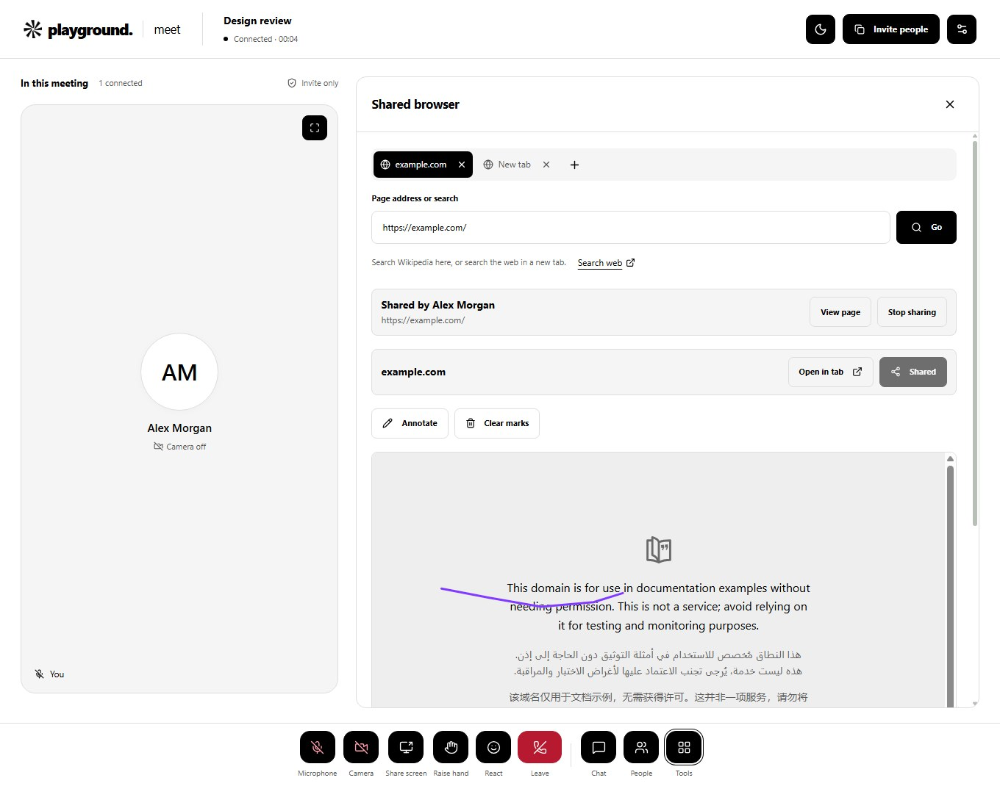
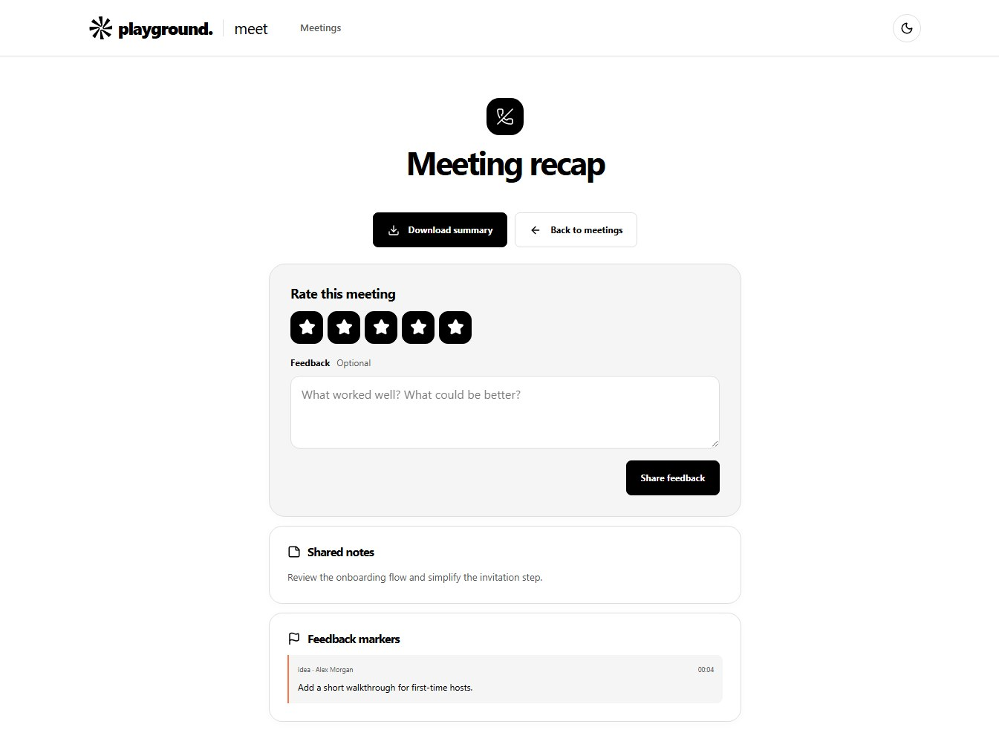

# Playground Meet

Start a video call from your browser, invite people with a link, and keep the discussion and feedback in one place. Playground Meet pairs LiveKit calls with a shared browser, notes, a whiteboard, and an exportable meeting recap.

[**Open Playground Meet**](https://playground-meet.vercel.app/) · [Run locally](#run-locally) · [Deploy on Vercel](docs/VERCEL.md) · [MIT license](LICENSE)



## What you can do

| Feature                  | What it does                                                                                                                                                                                       |
| ------------------------ | -------------------------------------------------------------------------------------------------------------------------------------------------------------------------------------------------- |
| **Start or join a call** | Create a meeting as a guest, share its invite link, and check your camera and microphone before joining. Sign in to keep meeting history across devices.                                           |
| **Run the meeting**      | Admit guests from the waiting room, lock the room, moderate participants, or end the call for everyone. Share your screen and pin a participant in your own view.                                  |
| **Browse together**      | Open up to five tabs, search Wikipedia, and share one HTTPS page at a time. Participants can draw on the shared preview. Use screen sharing for sites that block embeds or to show live scrolling. |
| **Work together**        | Use chat, reactions, raised hands, shared notes, a whiteboard, polls, a focus timer, and a product review brief.                                                                                   |
| **Follow up**            | Review notes and timestamped feedback, rate the meeting, and download a Markdown summary.                                                                                                          |

Invites and recaps use the branded `/playground-meet/` route. Existing `/room/` links redirect to the same meeting.

## A look inside

These screenshots show the current local build with example meeting data.

| Device check                                                                                         | In-call tools                                                         |
| ---------------------------------------------------------------------------------------------------- | --------------------------------------------------------------------- |
|  |  |

| Shared browser                                                                                        | Meeting recap                                                                                      |
| ----------------------------------------------------------------------------------------------------- | -------------------------------------------------------------------------------------------------- |
|  |  |

## Run locally

Install Node.js 22 or later and a [local LiveKit server](https://docs.livekit.io/transport/self-hosting/local/).

```sh
git clone https://github.com/PRABHMANNAT/playground-meet.git
cd playground-meet
npm ci
cp .env.example .env.local
livekit-server --dev --bind 127.0.0.1
```

On Windows, use `Copy-Item .env.example .env.local` and run the LiveKit Windows executable. In a second terminal, start the app.

```sh
npm run dev
```

Open [localhost:3000](http://localhost:3000/). Local data persists in PGlite under `.data/meet`, so you can start without a hosted database. See the [local development guide](docs/LOCAL-DEVELOPMENT.md) for configuration and troubleshooting.

## Deploy and verify

- [Vercel](docs/VERCEL.md) connects the Next.js app to hosted PostgreSQL and LiveKit. You can use the assigned `vercel.app` domain.
- [Docker](docs/DEPLOYMENT.md) runs the stack on your own host with HTTPS and TURN.
- [Architecture](docs/ARCHITECTURE.md), [security](docs/SECURITY.md), and [Playground SSO](docs/INTEGRATION.md) cover the app and its integrations.

The app uses Next.js, TypeScript, and React. LiveKit carries media over WebRTC. PostgreSQL stores meeting state in production. Rooms support up to 25 identities.

```sh
npm run typecheck
npm test
npm run build

# With the app and LiveKit running locally
npm run test:links
npm run test:integration
npm run test:media
```

See the [testing guide](docs/TESTING.md) for coverage and test requirements.

## Contributing and license

Open a [GitHub issue](https://github.com/PRABHMANNAT/playground-meet/issues) with reproduction steps for bugs or a short description of the workflow you want to improve. See [SECURITY.md](docs/SECURITY.md) for the app's security model.

The project code is available under the [MIT License](LICENSE). Playground branding, bundled fonts, and other third-party assets retain their respective rights. See [THIRD-PARTY-NOTICES.md](THIRD-PARTY-NOTICES.md).
